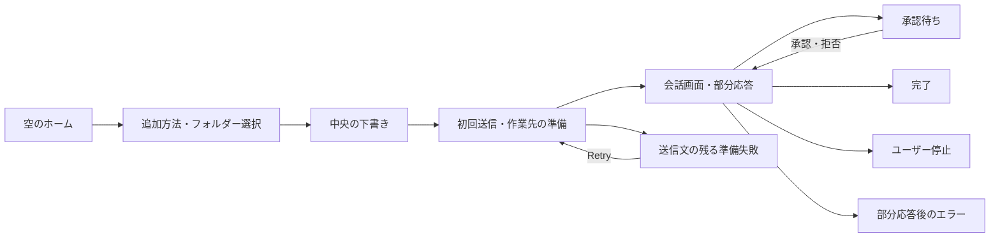

# UI の原本と状態遷移

[ソースに基づく全61画面の仕様](source/README.md) · [画面 ID と原本コード行](source/state-index.tsv) · [対応する採取 ID・未確認条件](states.tsv)。原本のうち53仕様に直接対応する実機の画面記録があり、残る8仕様は追加条件が必要。画面の到達とその画面の全操作の検証は別の判定として扱う。

| 原本の描画幅 | 下書きの入力 x / 幅 | 詳細を開いた x / 幅 | 右パネルを開いた x / 幅 |
|---:|---:|---:|---:|
| 900 | 318 / 521 | 318 / 521 | 318 / 521 |
| 1080 | 318 / 701 | 318 / 701 | 318 / 238 |
| 1440 | 493.5 / 710 | 393 / 710 | 318 / 521 |

高さ720、倍率1、英語・ダークのテスト条件。1080は実ウィンドウで確認し、900と1440は配布レンダラーの viewport を変更した。1080 の詳細ポップオーバーは x780 / y52 / 幅296 / 高さ247。作業用右パネルが開くと入力欄が463縮む。座標は左上原点の CSS px、Swift 比較の寸法は pt。[実測表](panel-measurements.tsv) · [実測値から描いた配置図](layout.html) · [SwiftUI/AppKit の配置試作](../methods/layout-experiment/LayoutProbe.swift) · [候補の計測結果](../results/layout-experiment.tsv)

[captures.tsv](captures.tsv) の採取 ID で [geometry.tsv](geometry.tsv) を絞ると、原本の画面要素の順序、領域、文字寸法、余白、角丸、文字色・背景色が分かる。調査用の端末名・パス・入力値は取り出していない。既知の共通操作だけにラベルが入る。設定のスクロール外や背面にマウントされていた要素もあり得るため、矩形の存在だけでは操作可能と判定しない。

[Swift 配布版13状態](swift-captures.tsv) · [Swift の AX 役割と矩形](swift-geometry.tsv) · [5本の短い観測の相対フレーム時刻](../results/transition-timing.tsv)。公開表はレイアウトの再現用で、実画像や会話ログを復元する形式ではない。
